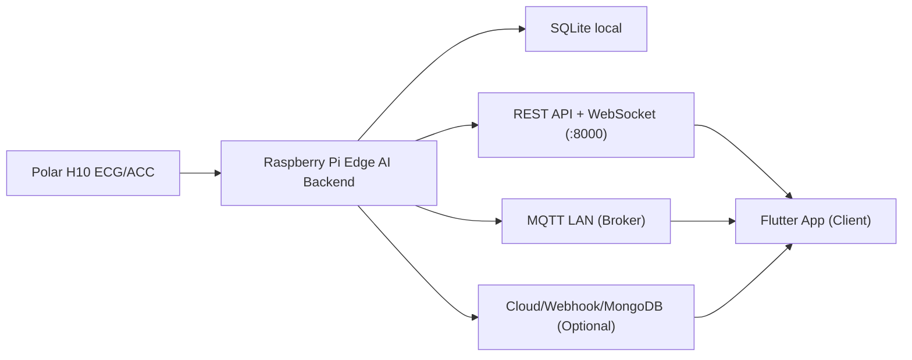

# Elder Health Monitor (Flutter Client App)

Ứng dụng Flutter theo dõi sức khỏe người cao tuổi từ Raspberry Pi/Edge AI backend. Hỗ trợ chạy đa nền tảng: **Windows Desktop**, **Android Mobile** và **Web**. 

Giao diện được tối ưu hóa cho người cao tuổi (với ngôn ngữ thân thiện, dễ hiểu, tránh thuật ngữ kỹ thuật phức tạp) và cung cấp bảng điều khiển chi tiết dành cho người chăm sóc/giám sát (Caregiver).

---

## 1. Kiến trúc Hệ thống & Luồng Dữ liệu



* **Backend:** Là một kho lưu trữ riêng biệt (chạy FastAPI trên Raspberry Pi). Backend thực hiện thu thập dữ liệu điện tâm đồ (ECG) và gia tốc (ACC) từ đai đeo Polar H10, chạy các mô hình AI tại chỗ để phát hiện bất thường (ví dụ: Rung tâm nhĩ - AFib, Ngoại tâm thu - PVC/PAC, Té ngã), lưu trữ cơ sở dữ liệu SQLite cục bộ và phát thông tin qua các giao thức REST API, WebSocket và MQTT.
* **Client (Repo này):** Nhận dữ liệu thời gian thực từ các giao thức trên để cập nhật giao diện Dashboard, phát cảnh báo khẩn cấp và hiển thị lịch sử sức khỏe.

---

## 2. Cấu trúc Thư mục Mã nguồn (Flutter App)

Kiến trúc mã nguồn được tổ chức theo mô hình phân chia theo tính năng (Feature-first) kết hợp lớp lõi (Core) dùng chung:

```text
lib/
├── core/                  # Các thành phần dùng chung toàn bộ ứng dụng
│   ├── constants/         # Định nghĩa Màu sắc, Chuỗi hiển thị, MQTT Topic
│   ├── models/            # Lớp thực thể dữ liệu (Vitals, Alert, Report, Profile)
│   ├── providers/         # Quản lý trạng thái ứng dụng (Provider State Management)
│   ├── repositories/      # Quản lý lưu trữ dữ liệu cục bộ (Hive)
│   ├── services/          # Các dịch vụ kết nối ngoại vi (API, WS, MQTT, Storage, Provisioning)
│   ├── utils/             # Các lớp tiện ích (Mapping dữ liệu y tế, chính sách thông báo)
│   └── widgets/           # Widget dùng chung toàn hệ thống
├── features/              # Các mô-đun chức năng nghiệp vụ của ứng dụng
│   ├── alerts/            # Alert Center (Danh sách cảnh báo, ACK/Resolve cảnh báo)
│   ├── dashboard/         # Trang chính của Người đeo (Wearer) và Người giám sát (Caregiver)
│   ├── history/           # Biểu đồ xu hướng nhịp tim (HR) và biến thiên nhịp tim (HRV)
│   ├── onboarding/        # Màn hình cấu hình ban đầu, kết nối Gateway và Setup Wi-Fi Raspberry
│   ├── profile/           # Thông tin người đeo, bệnh nền, thuốc uống & điều chỉnh ngưỡng sinh hiệu
│   ├── report/            # Biển diễn báo cáo sức khỏe trực quan trên UI
│   ├── reports/           # Logic tạo báo cáo PDF và lưu trữ báo cáo định kỳ
│   └── settings/          # Cài đặt Gateway, API Key, Demo Mode, chuẩn đoán kỹ thuật nâng cao
├── router/                # Cấu hình định tuyến màn hình ứng dụng (App Router)
└── main.dart              # Điểm khởi chạy ứng dụng
```

---

## 3. Vai trò Người dùng & Luồng Nghiệp vụ

### A. Người đeo thiết bị (Wearer)
* **Môi trường hoạt động:** Thường ở gần cổng kết nối Raspberry Pi trong mạng nội bộ (LAN).
* **Kết nối mặc định:** Cấu hình gateway trỏ tới địa chỉ local của Pi (ví dụ: `http://elderlycare.local:8000` hoặc IP tĩnh của Pi trong mạng Wi-Fi).
* **Thông tin lưu trữ:** Tên, tuổi, thông tin liên hệ khẩn cấp, mã thiết bị được lưu trữ an toàn trong Local Storage bằng **Hive**.

### B. Người giám sát (Caregiver)
* **Môi trường hoạt động:** Có thể ở cùng mạng LAN hoặc theo dõi từ xa (qua Cloud/VPN/Reverse Proxy).
* **Luồng dữ liệu realtime:**
  - Nhận cảnh báo nguy hiểm thời gian thực thông qua kết nối WebSocket `/ws/alerts`.
  - Nhận chỉ số sinh hiệu thời gian thực qua WebSocket `/ws/vitals`.
  - Có cơ chế dự phòng tự động chuyển sang cơ chế HTTP Polling định kỳ 10 giây nếu mất kết nối WebSocket.

---

## 4. Cơ chế Cấu hình & Ánh xạ Cảnh báo từ AI Backend

Để tạo trải nghiệm thân thiện với người dùng lớn tuổi, ứng dụng thực hiện chuyển đổi các thuật ngữ y học phức tạp từ AI backend thành các thuật ngữ đời thường dễ hiểu:

* **Từ viết tắt y khoa:**
  - `AFib` (Rung tâm nhĩ) $\rightarrow$ **Dấu hiệu nhịp tim không đều**.
  - `PVC/PAC` (Ngoại tâm thu) $\rightarrow$ **Nhịp đập đến sớm**.
  - `RMSSD / HRV` (Biến thiên nhịp tim) $\rightarrow$ **Mức độ phục hồi / Căng thẳng cơ thể**.
  - `Baseline` $\rightarrow$ **Mức bình thường của riêng bạn**.

* **Phân cấp cảnh báo (4 mức độ):**

| Backend Level | Trạng thái hiển thị trên UI | Ý nghĩa & Hành động tương ứng |
|---|---|---|
| `SAFE` / `normal` | **Ổn định** | Sinh hiệu trong ngưỡng an toàn bình thường. |
| `WATCH` / `medium` | **Cần theo dõi** | Sinh hiệu hơi lệch nhẹ, cần chú ý nghỉ ngơi. |
| `ALERT` / `high` | **Cần kiểm tra** | Có bất thường rõ rệt, cần người nhà kiểm tra trực tiếp. |
| `CRITICAL` / `critical` | **Cần hỗ trợ ngay** | Té ngã nghiêm trọng hoặc nhịp tim cực đoan $\rightarrow$ Hỗ trợ khẩn cấp. |

* **Xử lý Cảnh báo khẩn cấp:**
  - Mọi cảnh báo khẩn cấp chưa được xử lý sẽ nhảy Popup trên màn hình của Người giám sát.
  - Người giám sát sau khi kiểm tra tình hình người cao tuổi cần nhấn nút xác nhận **Đã kiểm tra** (`POST /alerts/{event_id}/ack`) hoặc **Đã xử lý** (`POST /alerts/{event_id}/resolve`) để tắt trạng thái nhắc nhở lặp đi lặp lại từ hệ thống.

---

## 5. Danh sách Endpoints API App đang sử dụng

### REST API
* `GET /health` - Kiểm tra trạng thái hoạt động của Backend.
* `GET /latest-result` - Lấy sinh hiệu và phân tích mới nhất của người đeo.
* `GET /history` - Lấy lịch sử nhịp tim để vẽ biểu đồ.
* `GET /events` - Lấy toàn bộ dòng thời gian (timeline) sự kiện cảnh báo.
* `GET /alerts/realtime` - Lấy danh sách các cảnh báo khẩn cấp đang diễn ra (chưa ACK).
* `POST /alerts/{event_id}/ack` - Người giám sát xác nhận đã kiểm tra sự kiện cảnh báo.
* `POST /alerts/{event_id}/resolve` - Người giám sát đánh dấu sự kiện đã được giải quyết xong.
* `GET /health-report` - Lấy dữ liệu tổng hợp phục vụ báo cáo sức khỏe định kỳ.
* `POST /polar/start` - Gửi lệnh bắt đầu thu dữ liệu từ cảm biến Polar H10 thủ công.
* `GET /guided-baseline/status` - Lấy trạng thái quá trình đo baseline.
* `POST /guided-baseline/start` - Bắt đầu quy trình đo baseline cho người dùng mới.

### WebSockets
* `/ws/vitals` - Stream dữ liệu nhịp tim và sinh hiệu thời gian thực.
* `/ws/alerts` - Stream cảnh báo bất thường khẩn cấp thời gian thực.

### Thiết lập Wi-Fi cho Raspberry Pi (Provisioning Portal)
Khi Raspberry Pi hoạt động ở chế độ Access Point thiết lập (`ElderlyCare-Setup-XXXX`), ứng dụng sẽ kết nối và gửi cấu hình Wi-Fi nhà thông qua các endpoint:
* `http://10.42.0.1/api/wifi/scan` - Quét danh sách Wi-Fi xung quanh Raspberry Pi.
* `http://10.42.0.1/api/wifi/connect` - Gửi SSID và Password Wi-Fi để Raspberry kết nối vào mạng nhà.

### Headers Xác thực & Định danh
* `X-API-Key`: Khóa API dùng để xác thực quyền truy cập khi backend bật chế độ bảo mật (`API_AUTH_ENABLED=1`).
* `X-Device-Code`: Mã định danh duy nhất của thiết bị Polar/Người đeo.
* `X-Access-Code`: Mã truy cập phân quyền dành riêng cho người giám sát.

---

## 6. Hướng dẫn Cài đặt & Chạy ứng dụng

### Yêu cầu hệ thống
* **Flutter SDK:** `>=3.2.0 <4.0.0`
* **Windows Build:** Đã cài đặt **Visual Studio Desktop Development with C++** (nếu muốn build ứng dụng chạy trực tiếp trên Windows).
* **Android Build:** Cài đặt **Android SDK & Emulator** (nếu muốn build ứng dụng Mobile).

### Các bước cài đặt và khởi chạy

1. **Tải các gói thư viện phụ thuộc:**
   ```bash
   flutter pub get
   ```

2. **Chạy ứng dụng trên môi trường giả lập/thiết bị thật:**
   * **Windows Desktop:**
     ```bash
     flutter run -d windows
     ```
   * **Web Browser:**
     ```bash
     flutter run -d chrome
     ```
   * **Android Mobile:**
     ```bash
     flutter run -d android
     ```

---

## 7. Đóng gói Demo chạy Web bằng Docker

Ứng dụng cung cấp cấu hình Docker để đóng gói phiên bản Web chạy qua máy chủ Web Nginx gọn nhẹ. Rất phù hợp khi cần triển khai bản demo nhanh trên máy tính cá nhân.

* **Lưu ý quan trọng:** Địa chỉ `ELDERLY_CARE_CLOUD_URL` lúc build phải là địa chỉ mà trình duyệt máy tính có thể truy cập được. Nếu backend FastAPI cũng chạy trên cùng máy tính, hãy cấu hình IP localhost: `http://127.0.0.1:8000`.

1. **Build Docker Image:**
   ```bash
   docker build ^
     --build-arg ELDERLY_CARE_CLOUD_URL=http://127.0.0.1:8000 ^
     -t elder-health-monitor:web .
   ```

2. **Khởi chạy Docker Container:**
   ```bash
   docker run --rm -p 8080:80 elder-health-monitor:web
   ```

3. **Truy cập ứng dụng:**
   Mở trình duyệt bất kỳ tại địa chỉ: `http://localhost:8080`

---

## 8. Chế độ Demo không cần Backend (Demo Mode)

Trong màn hình **Cài đặt** (Settings), người dùng có thể kích hoạt **Demo Mode**. 
* Khi bật chế độ này, ứng dụng sẽ tự động ngắt kết nối với backend vật lý và tự động sinh dữ liệu sinh hiệu giả lập để kiểm tra và thuyết trình nhanh giao diện người dùng mà không cần đai đeo Polar hay Raspberry Pi hoạt động.
* *Lưu ý:* Vô hiệu hóa chế độ Demo này khi tiến hành kiểm thử thực tế với cảm biến thật.

---

## 9. Hướng dẫn Kiểm thử (Testing)

Chạy bộ công cụ kiểm thử tự động được tích hợp sẵn:

```bash
# Chạy toàn bộ Unit và Widget test
flutter test

# Kiểm tra phân tích tĩnh mã nguồn đảm bảo chuẩn cú pháp Dart
flutter analyze --no-fatal-infos

# Build thử phiên bản debug Windows
flutter build windows --debug
```

---

## 10. Checklist Bàn giao kỹ thuật (Handover Checklist)

Trước khi bàn giao mã nguồn cho đội ngũ phát triển tiếp theo, hãy thực hiện kiểm tra các tiêu chí sau:

- [ ] **Lưu thông tin cục bộ:** Đảm bảo Hive lưu trữ thành công các trường thông tin cá nhân của người đeo (Tên, Tuổi, Caregiver ID) và không bị mất sau khi tắt app.
- [ ] **Xác thực kết nối Gateway:** Thử nghiệm thay đổi địa chỉ IP Gateway trong Settings và nhấn **Kiem tra /health** báo thành công (Backend phản hồi `200 OK`).
- [ ] **Nhận tin nhắn Realtime:** Dashboard cập nhật chỉ số nhịp tim nhảy liên tục (WebSockets `/ws/vitals` đang chạy tốt hoặc Polling fallback hoạt động ổn định).
- [ ] **Màn hình Alert Center:** Nhận đầy đủ danh sách sự kiện từ `/events` và có khả năng tương tác ACK để chuyển trạng thái cảnh báo khẩn cấp.
- [ ] **Chế độ Demo hoạt động độc lập:** Khi ngắt mạng và bật Demo mode, giao diện giả lập chạy trơn tru không bị crash hoặc treo luồng xử lý.
