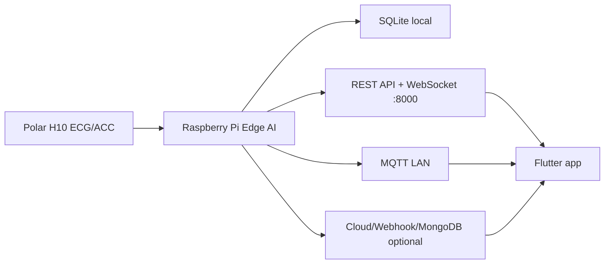

# Elder Health Monitor

Ung dung Flutter theo doi suc khoe nguoi cao tuoi tu Raspberry Pi/Edge AI backend. App hien tap trung vao khung on dinh cho demo Windows/Android/Web, hien thi thong tin theo ngon ngu de hieu va tach du lieu ky thuat vao phan rieng.

## Kien truc hien tai



Backend chinh nam o repo `D:\DATN\elderly_care-amine\elderly_care-amine`. Raspberry thu tin hieu Polar H10, chay model tai cho, luu local va phat du lieu/canh bao qua REST, WebSocket, MQTT. MongoDB chi la kenh dong bo/luu tru, khong phai duong realtime duy nhat.

## Vai tro nguoi dung

- **Nguoi deo:** dung gateway noi bo Raspberry, mac dinh `elderlycare.local:8000` hoac IP Pi.
- **Nguoi giam sat:** dung cloud/base URL duoc cau hinh trong build, uu tien WebSocket `/ws/alerts` va `/ws/vitals`, fallback HTTP polling.

Thong tin onboarding nhu ten, tuoi, nguoi giam ho, ma thiet bi va ma truy cap duoc luu bang Hive trong local storage.

## Tinh nang chinh

- Dashboard "Tinh trang hien tai" voi ngon ngu pho thong cho nguoi cao tuoi.
- Canh bao 4 muc: `On dinh`, `Can theo doi`, `Can kiem tra`, `Can ho tro ngay`.
- Alert Center nhan canh bao tu `/alerts/realtime`, `/events`, WebSocket va co CTA xac nhan da kiem tra.
- History va Health Summary lay du lieu tu backend.
- Settings cau hinh Raspberry gateway, API key, demo mode, Polar manual start va phan "Du lieu ky thuat".
- Man hinh thiet lap Wi-Fi Raspberry qua AP `ElderlyCare-Setup-XXXX` khi Pi den mang moi.

## Backend/API app dang dung

Endpoint chinh:

- `GET /health`
- `GET /latest-result`
- `GET /history`
- `GET /events`
- `GET /alerts/realtime`
- `POST /alerts/{event_id}/ack`
- `POST /alerts/{event_id}/resolve`
- `GET /health-report`
- `POST /polar/start`
- `GET /guided-baseline/status`
- `POST /guided-baseline/start`
- `POST /guided-baseline/segment/complete`
- `POST /guided-baseline/complete-day`

WebSocket:

- `/ws/vitals`
- `/ws/alerts`

Wi-Fi provisioning portal:

- `http://10.42.0.1/api/wifi/scan`
- `http://10.42.0.1/api/wifi/connect`

Headers:

- `X-API-Key`: backend auth khi `API_AUTH_ENABLED=1`.
- `X-Device-Code`: ma thiet bi cua nguoi deo, luu trong app.
- `X-Access-Code`: ma truy cap cua caregiver, luu trong app.

## Yeu cau cai dat

- Flutter SDK `>=3.2.0 <4.0.0`
- Dart SDK theo Flutter
- Windows: Visual Studio Desktop Development with C++ neu build desktop
- Android: Android SDK/emulator neu test mobile
- Backend Raspberry/FastAPI neu test du lieu that

## Chay app

Tai dependencies:

```bash
flutter pub get
```

Chay Windows desktop:

```bash
flutter run -d windows
```

Chay Web:

```bash
flutter run -d chrome
```

## Chay demo bang Docker tren laptop

Docker trong repo nay dung de dong goi ban **Flutter Web** va serve bang Nginx.
Day la cach phu hop cho bao cao/thuyet trinh tren laptop: mo app trong browser tai
`http://localhost:8080`, con backend FastAPI van chay rieng o `:8000`.

Luu y quan trong: `ELDERLY_CARE_CLOUD_URL` la dia chi ma **browser tren laptop**
truy cap duoc, khong phai dia chi noi bo trong container. Neu backend cung chay
tren laptop, dung `http://127.0.0.1:8000`.

Build image:

```bash
docker build ^
  --build-arg ELDERLY_CARE_CLOUD_URL=http://127.0.0.1:8000 ^
  -t elder-health-monitor:web .
```

Chay container:

```bash
docker run --rm -p 8080:80 elder-health-monitor:web
```

Mo app:

```text
http://localhost:8080
```

Neu backend khong chay tren laptop ma chay tren Raspberry cung mang, build voi IP
Raspberry:

```bash
docker build ^
  --build-arg ELDERLY_CARE_CLOUD_URL=http://<IP_RASPBERRY>:8000 ^
  -t elder-health-monitor:web .
```

Neu backend bat `API_AUTH_ENABLED=1`, nhap API key trong onboarding/Settings cua app.
Backend can cho phep CORS tu browser demo, vi du `ALLOWED_ORIGINS=*` trong moi truong
demo LAN.

Chay Android:

```bash
flutter run -d android
```

Build Windows debug:

```bash
flutter build windows --debug
```

## Cau hinh ket noi Raspberry

Trong app vao **Cai dat**:

1. Nguoi deo nhap dia chi Raspberry: `elderlycare.local`, `10.x.x.x`, hoac `http://10.x.x.x:8000`.
2. Neu backend bat auth, nhap API key trung voi `.env` backend.
3. Bam kiem tra ket noi qua `/health`.
4. Neu Raspberry chua vao Wi-Fi nha, dung man **Thiet lap Wi-Fi Raspberry**, ket noi vao AP `ElderlyCare-Setup-XXXX`, nhap Wi-Fi nha va quay lai mang nha.

Luu y: `0.0.0.0` chi la dia chi bind server, khong phai dia chi de app/browser truy cap. Dung `127.0.0.1` chi khi app chay tren chinh may backend. May khac phai dung IP Raspberry hoac `elderlycare.local`.

## Checklist cai app khi lap tai nha

Dung checklist nay sau khi Raspberry da duoc cap nguon va backend da cai theo README backend.

### 1. Ket noi app voi Raspberry

1. Mo app va chon dung vai tro.
2. Neu app dung cho nguoi deo/cung mang nha, vao **Cai dat** va nhap gateway:
   - `elderlycare.local`, hoac
   - IP Raspberry, vi du `10.10.56.149`, hoac
   - URL day du, vi du `http://10.10.56.149:8000`.
3. Neu backend bat `API_AUTH_ENABLED=1`, nhap API key trung voi `.env` backend.
4. Bam **Kiem tra /health**. Ket noi dung khi app bao backend san sang va khong hien mat ket noi.
5. Quay ve Dashboard, doi 10-20 giay de nhan `/latest-result`.

Khong nhap `0.0.0.0` vao app. Dia chi nay chi de backend lang nghe tren moi interface, khong phai dia chi client truy cap.

### 2. Xac nhan dang thu du lieu that

Dashboard can hien cac dau hieu:

- Trang thai Raspberry/Polar dang hoat dong.
- Nhip tim co gia tri moi.
- Khong bat demo mode khi test du lieu that.
- Neu Polar chua tu thu, dung nut **Bat thu Polar thu cong** trong Settings chi de debug; khi lap that, backend nen co `POLAR_AUTO_START=1`.

Neu app bao mat ket noi:

- Kiem tra laptop/dien thoai co cung Wi-Fi voi Raspberry khong.
- Thu `http://elderlycare.local:8000/health` hoac `http://<IP_RASPBERRY>:8000/health` tren browser.
- Neu backend bat auth, app phai co API key dung.
- Neu `elderlycare.local` khong resolve, dung IP lay tu `hostname -I` tren Pi.

### 3. Kiem tra canh bao

- Cac canh bao nhe nhu nhip tim cao/thap mot cua so, tin hieu kem, PVC/PAC don le se nam trong Dashboard/Alert Center/History, khong popup khan.
- Popup chi hien voi canh bao can kiem tra that su:
  - te nga hoac nghi te nga;
  - nhip tim cao keo dai khi nguoi dung it van dong;
  - nhip tim thap keo dai khi nguoi dung it van dong;
  - nhip tim nguy hiem khi nguoi dung bat dong;
  - dau hieu nhip tim khong deu muc cao do backend danh dau urgent.
- Alert Center lay canh bao khan tu `/alerts/realtime` va timeline day du tu `/events`.
- Sau khi da kiem tra nguoi dung, bam CTA da kiem tra de ACK alert, tranh app nhac lai cung mot canh bao.

### 4. Nguoi giam sat o xa

Neu app nguoi giam sat khac mang voi Raspberry:

- Khong dung IP LAN cua Pi neu khong co VPN/reverse proxy/cloud.
- Can mot dia chi cloud/VPN bao mat tro ve backend.
- Backend phai bat auth: `API_AUTH_ENABLED=1`, `API_KEY` du dai.
- App caregiver uu tien WebSocket `/ws/alerts` va `/ws/vitals`; khi mat WebSocket se fallback HTTP polling.
- MongoDB chi la kenh dong bo/luu tru, khong thay the realtime alert neu app khong co cloud API/WebSocket de doc.

### 5. Tieu chi ban giao app

- [ ] App luu duoc thong tin nguoi deo: ten, tuoi, nguoi giam ho, so dien thoai.
- [ ] Settings co gateway/API key dung.
- [ ] **Kiem tra /health** thanh cong.
- [ ] Dashboard co nhip tim moi tu backend.
- [ ] Alert Center doc duoc `/events`.
- [ ] Canh bao urgent chua ACK xuat hien trong `/alerts/realtime`.
- [ ] Demo mode tat khi thu du lieu that.

## Demo mode

`demo_mode` mac dinh la `false`. Khi bat trong Settings/local storage, app sinh mock data de test UI ma khong can backend. Khong dung demo mode cho test realtime/production.

## Kiem thu

```bash
flutter test
flutter analyze --no-fatal-infos
flutter build windows --debug
```

Smoke test thu cong:

- Mo app lan dau, chon vai tro va nhap thong tin co ban.
- Khong co backend: app hien mat ket noi ro rang, khong crash.
- Co Raspberry backend: Dashboard cap nhat `/latest-result`, Alert Center co `/alerts/realtime` va `/events`.
- Caregiver reconnect: canh bao high/critical chua ack van hien lai.
- Wi-Fi setup: portal `10.42.0.1` scan va gui cau hinh Wi-Fi.

## Ghi chu production

- Web target khong nen dung raw TCP MQTT (`mqtt_client` voi socket) vi Flutter Web khong ho tro `SecurityContext` mac dinh. Web nen dung REST/WebSocket hoac MQTT-over-WebSocket neu backend/broker cau hinh rieng.
- Cac tinh nang PDF, guided baseline va notification native dang duoc giu nhu tinh nang phu/advanced, khong phai luong chinh cua khung demo on dinh.
